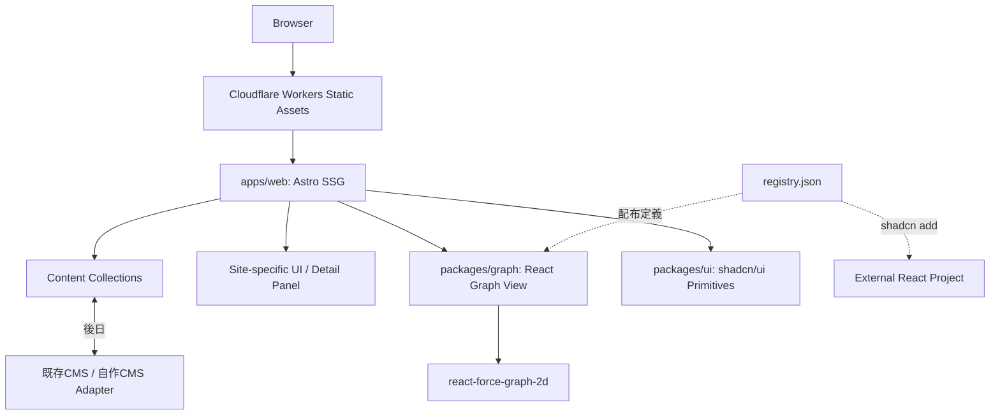
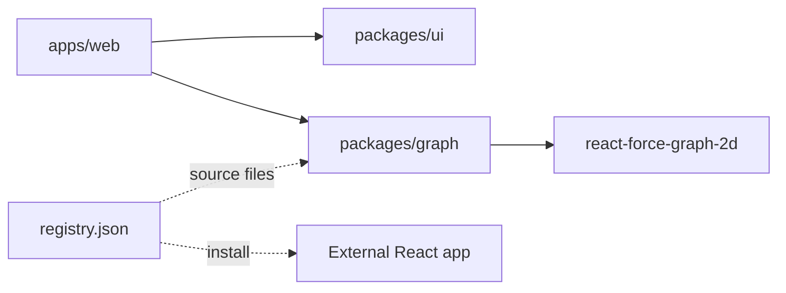
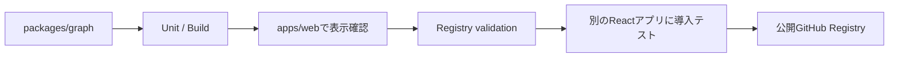

# アーキテクチャ

> Status: 設計方針（実装は段階的に移行）  
> Updated: 2026-10-12

## 全体構成

## Workspaceと依存方向

| 層 | 配置 | 責務 | 依存規則 |
| --- | --- | --- | --- |
| サイト | `apps/web` | Astro、記事・作品、CMS変換、サイト固有のGraph UI | `packages/ui`、`packages/graph`に依存可 |
| 標準UI | `packages/ui` | 導入したshadcn/ui部品、共有ユーティリティ | Astro、CMS、Graphのサイト実装に依存しない |
| 汎用Graph | `packages/graph` | GraphView、操作フック、公開型 | `packages/ui`・`apps/web`・Astroへ依存しない |
| 配布定義 | `registry.json` | Graph Viewの配布対象とnpm/registry依存を宣言 | コンポーネント本体の複製を持たない |

## Graphコンポーネントの境界

| コンポーネント | 所属 | 公開方針 |
| --- | --- | --- |
| `GraphView` | `packages/graph` | `graph-view` Registryアイテム |
| `GraphControls` | `packages/graph` | 初期はGraphViewに同梱 |
| `GraphSelection` | `packages/graph` | 内部実装 |
| `GraphTooltip` | `packages/graph`または呼び出し側 | 必要性に応じて実装 |
| `GraphDetailPanel` | `apps/web` | サイト固有、公開しない |
| `GraphDataAdapter` | `apps/web` | CMS固有、公開しない |
| shadcn Button・Tooltip等 | `packages/ui` | 公式部品として導入、独自Registryでは原則配布しない |

### データモデルの独立性

- `GraphNode` / `GraphEdge`はCMSや描画ライブラリの内部オブジェクトに依存させない。
- 座標、force simulation、Canvas等の一時状態は描画用コピーに保持する。
- `GraphView`は`nodes`、`edges`、`selectedNodeId`、`onNodeSelect`など汎用propsで制御する。
- Graphとサイト固有の詳細パネルはprops・callbackで接続する。
- キーボードで利用できるHTMLベースの代替ナビゲーションを提供する。

## shadcn Registry公開

`packages/graph`をSingle Source of Truthとし、リポジトリルートの`registry.json`から公開する。npmパッケージ化を初期の必須条件にしない。

- Registry経由でコピーされたコードに`@site/ui`や`@site/graph`等のworkspace固有importを残さない。
- 公式shadcn部品が必要なら`registryDependencies`で宣言するか外部から合成する。
- Registryアイテムは初期`graph-view`のみ。個別のControlsやTooltipへの分割は需要が出た時点で判断する。
- Astro固有コード・CMS依存・Portfolio固定文言を公開コンポーネントへ持ち込まない。

## 配信・運用

- 初期はAstro SSG。Cloudflare Workers Static Assetsで配信する。
- ビルドと品質ゲートはGitHub Actions。Biome、Fallow、TypeScript、Vitest、Playwrightを役割ごとに運用する。
- CMS導入時もまず静的ビルド時取得を基本とし、SSRは要件が生じてから再評価する。
- Rust/WASM + WebGPUへの描画置換は研究段階。Graphデータモデルは保持する。

詳細は[TECH_STACK.md](./TECH_STACK.md)を参照。
