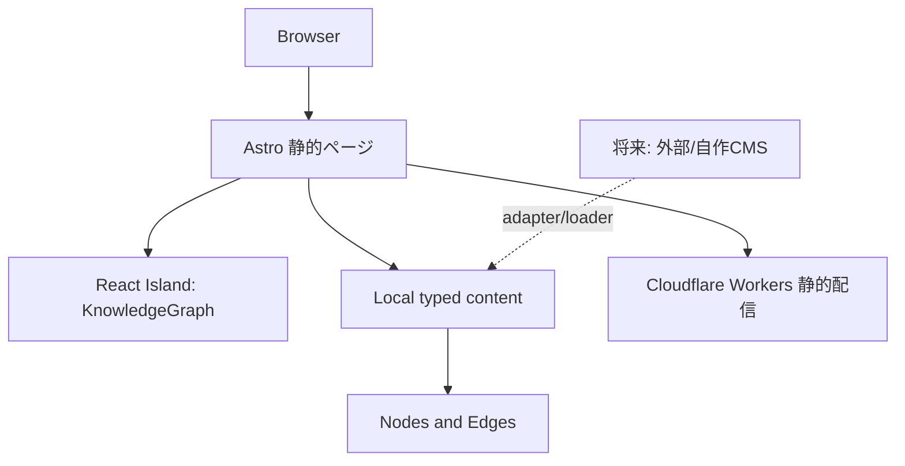

# アーキテクチャ

## 境界
- Astro: URL、文書構造、静的レンダリング、SEO
- React Island: グラフのローカル選択状態と視覚的フィードバック
- `src/data/site.ts`: 初期コンテンツ・関係データ。ページにはCMS固有モデルを渡さない
- CMS/Loader: 記事をサイトの共通コンテンツモデルへ変換する（将来）

## 方針
1. SSR不要、AstroのデフォルトSSGで構築
2. グラフは固定配置SVGで開始。ノード数が増えるまで力学エンジンを採用しない
3. JavaScriptに依存しない通常のリンクを維持
4. ノードは一意ID、エッジはsource/targetを持つ
5. 作品データは仮置き。公開前に実データと差し替える

## Cloudflare
初期は生成された静的アセットをCloudflare Workersに配信する。配信設定は本番環境構築のIssueで確定する。CMS追加時もビルド時データ取得を基本とする。
