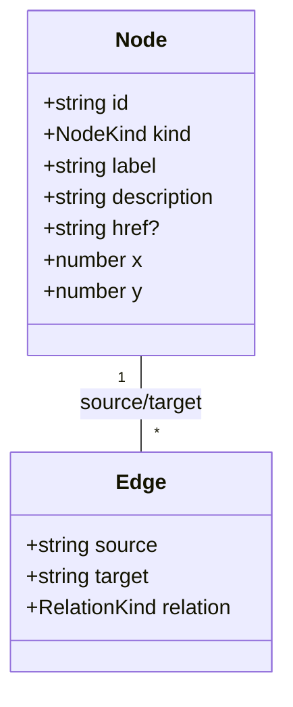

# コンテンツモデル

## 種別
`idea | work | writing | experiment | about`

## 関係
`inspires | produces | documents | relates_to`。方向性を持つがグラフ描画上は双方向にハイライトしてよい。

## 整合性制約
- ノードIDは重複禁止。URLに使うslugは公開後に原則変更しない
- `source`と`target`は存在するノードのIDである
- 関係を説明できないエッジは追加しない
- 未公開コンテンツへはリンクしない

## 将来のCMS
`Post {id, slug, title, summary, publishedAt, tags, body}`と`Work {id, slug, title, summary, links}`を別々に管理。ビルド時に正規化して表示モデルへ変換。リッチテキスト、画像、公開状態の移行についてはCMS確定後に設計する。
