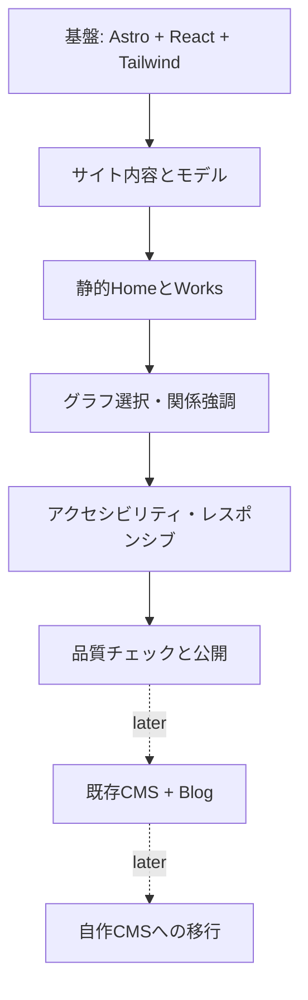

# 実装計画

## Issue候補
### Epic 1: Foundation
- [ ] Astroアプリ初期化・React統合・Tailwind導入
- [ ] `check/build`をCI化
- [ ] 共通レイアウトとメタデータ

### Epic 2: Content
- [ ] コンセプト文とプロフィール確定
- [ ] 代表作品選定と情報投入
- [ ] コンテンツID・関連付けを検証

### Epic 3: Experience
- [ ] Graph選択と関連強調
- [ ] Graph情報パネルとページリンク
- [ ] レスポンシブ・通常ナビ・reduced-motion

### Epic 4: Release
- [ ] Playwright等で主要導線を確認
- [ ] SEO・OGPとアクセシビリティ検証
- [ ] Cloudflare公開

## 後続
- [ ] Blog記事一覧・詳細とRSS
- [ ] 暫定Headless CMSへのLoader
- [ ] 自作CMSプロジェクトを分離して設計
