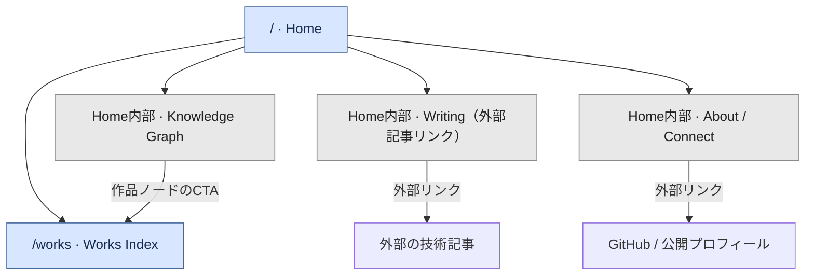
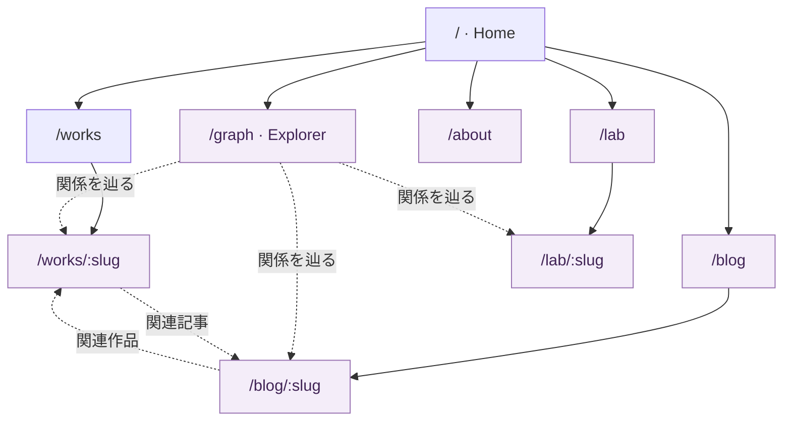
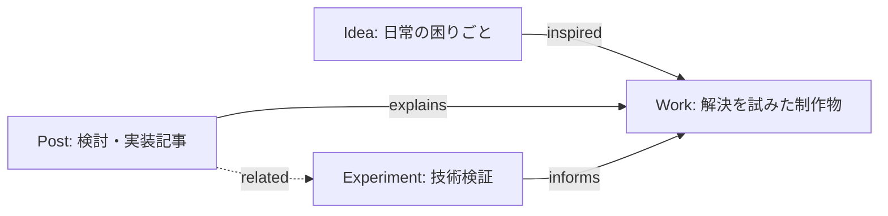
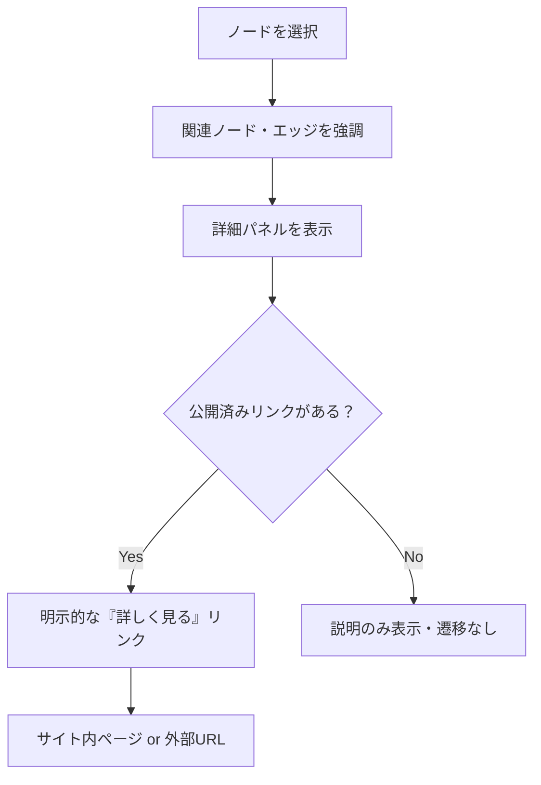
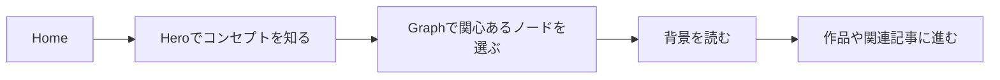
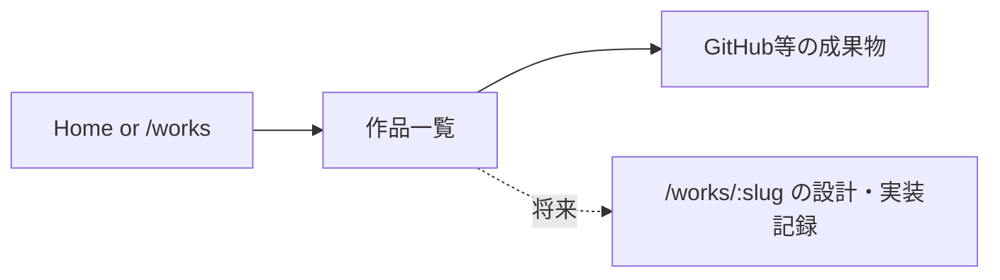
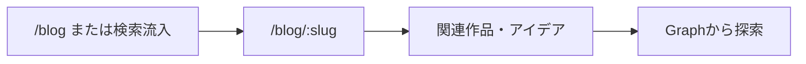

# SITEMAP.md — Personal Knowledge Website

> Status: Draft for implementation · Updated: 2026-10-12
> Concept: **アイデアは、日常に転がっている。**
>
> This document defines the **page hierarchy, navigation model, and relationship to the Knowledge Graph**. UI composition belongs in `UX.md` and `DESIGN.md`; technical details belong in `ARCHITECTURE.md` and `TECH_STACK.md`.

## 1. 設計の前提

本サイトは通常のPortfolioサイトであると同時に、アイデア・作品・記事・実験の関連性を探索する場所である。

- **Page Map**: URLで識別される閲覧可能なページの階層と導線。
- **Knowledge Graph**: コンテンツと概念の意味的な関連を示すネットワーク。**ノード＝ページではない**。
- グラフは探索の追加手段。主要情報は通常のナビゲーションとHTMLリンクでも到達できる。
- MVPの実装範囲は `/` と `/works` の2ルート。記事本文配信・CMS・Labページは対象外。
- 作品選定は未確定。サンプルデータを実績として公開しない。

## 2. ページ一覧と公開フェーズ

| URL | ページ | 役割 | MVP | 主な入口 |
|---|---|---|---|---|
| `/` | Home | コンセプト、グラフ、思想、作品、記事への入口 | **実装** | 直接アクセス、ロゴ |
| `/works` | Works Index | 公開可能な作品一覧 | **実装** | Header、Home、Graph詳細 |
| `/works/[slug]` | Work Detail | 課題・着想・設計・結果を深掘りする | 将来 | Works Index、Graph |
| `/blog` | Blog Index | 個人サイト内の記事一覧、カテゴリ・タグ導線 | 将来 | Header、Home、Graph |
| `/blog/[slug]` | Blog Article | 自作CMS・暫定CMSが提供する記事の本文 | 将来 | Blog Index、Graph、関連記事 |
| `/lab` | Lab Index | 試作品や未解決の実験一覧 | 将来 | Home、Graph |
| `/lab/[slug]` | Experiment Detail | 仮説・手順・結果・学び | 将来 | Lab Index、Graph |
| `/about` | About | 長文プロフィール・背景 | 将来 | Header、Home |
| `/graph` | Graph Explorer | フルスクリーンに近い探索体験 | 将来・必要性を検証 | Home |
| `/404` | Not Found | 存在しないURLの案内 | 公開時のホスティング挙動を確認 | 無効URL |

**補足**: `/404` はホスティングやAstroの取り扱いに応じて実装する。MVPに未実装のページを空のまま設けたり、404ページをサイトマップに掲載したりしない。

### 2.1 MVP Page Map

### 2.2 拡張後の Page Map（設計上の予約）

> 点線は意味的な関連やコンテンツへの導線を示す。画面階層の親子関係と同一ではない。

## 3. Homeの情報階層

| 順序 | セクション | 訪問者に伝えること | 主なアクション |
|---|---|---|---|
| 01 | Hero | 「アイデアは、日常に転がっている。」 | グラフへ進む、Worksへ移動 |
| 02 | Knowledge Graph | 発想・制作物・記事・実験の関係 | ノード選択、関係強調、詳細を見る |
| 03 | Philosophy | 日常の不便・疑問から制作へ | 背景を読む |
| 04 | Featured Works | 実際に作ったもの | `/works`、外部Repositoryなど |
| 05 | Writing | 開発で考えたこと | 既存の外部記事へ移動 |
| 06 | About / Connect | 何者か、どこで活動しているか | GitHub・連絡先など |

`UX.md` のセクション構成と整合を取る。HeroとGraphは視覚的にはひとつの領域にまとめてもよいが、意味上は別の責務を持つ。

## 4. Knowledge Graphとページの分離

### 4.1 ノード種別

| ノード種別 | 例 | URL必須か | MVPでの振る舞い |
|---|---|---|---|
| `idea` | 日常の不便・疑問 | いいえ | 詳細パネルに課題と関係を表示 |
| `work` | 公開済み制作物 | いいえ | 詳細パネルと、存在する場合だけCTA表示 |
| `post` | 考察・記事 | いいえ | 外部記事があればリンクを表示 |
| `experiment` | 未完成の検証 | いいえ | 関係・概要を表示。未公開ならリンクなし |
| `section` | Works / About等の集合的な入口 | 場合による | 既存ページやHome内セクションへの移動 |

`section` はナビゲーション上の便宜的ノード。CMSのコンテンツエンティティと混ぜない。

### 4.2 関連の考え方

具体的な作品や記事の紐付けは、実際に公開するコンテンツが選定された後に登録する。関係のないノードを見た目の都合でつながない。

### 4.3 ノード選択時の遷移

- ノードの**単クリックは選択**。直接遷移させない。
- パネルの明示的なリンクから移動する。外部リンクは移動先を認識できるラベルを使う。
- URLのない概念ノードにも意味がある。ダミーURLを与えない。
- グラフの詳細とサイト内ページは分離し、情報の重複は許容しつつ内容が矛盾しないようにする。

## 5. グローバルナビゲーション

| 場所 | MVPに表示 | 将来 |
|---|---|---|
| Header | Home、Works | Blog、Lab、Aboutを実装に応じて追加 |
| Hero | WorksへのCTA、グラフへの誘導 | Explore GraphへのCTA（必要時） |
| Footer | Home、Works、GitHub等 | Blog、Lab、RSSなど |
| Graph | 関連情報の選択と存在するURLのみ | 記事・実験の詳細へ横断遷移 |

**公開されていないルートをナビゲーションに載せない。** "Coming soon" のページを量産しない。

## 6. 典型的なユーザージャーニー

### 初見の一般読者

### 作品を見に来たエンジニア

### 記事を読みたい読者（将来）

## 7. レスポンシブとアクセシビリティ

| 観点 | Desktop | Mobile |
|---|---|---|
| Header | 通常の横並びリンク | コンパクトなナビゲーション |
| Graph | グラフ + 詳細パネルを横並び | グラフの下に詳細パネル |
| ノード操作 | ポインタ・キーボード | タップ・キーボード対応 |
| 代替導線 | 通常リンク一覧 | 通常リンク一覧 |
| モーション | 過度な自動移動を避ける | 低負荷・reduced-motion尊重 |

Canvasの描画要素はキーボードから直接操作しづらいことがあるため、**ノードと同等の操作が可能なHTMLの選択リスト**を提供する。Graphが動かなくても主要導線を維持する。

## 8. URL・SEOの規則

- 小文字のkebab-case slugを用い、公開したURLを安易に変更しない。
- 記事や作品は安定した識別子とslugを分けて管理できるようにする。
- `/works/[slug]` や `/blog/[slug]` は公開時に実データがあるものだけ生成する。
- 自サイト内ページごとにtitle、description、canonical、OGPを用意する。
- `sitemap.xml` は検索エンジン向けの**公開URL一覧**。本書のPage MapともKnowledge Graphとも別物。
- `sitemap.xml` に未実装URLや外部リンクは含めない。
- 将来CMSを変更してもURLが変わらないようにする。

## 9. 実装・検証チェックリスト

- [ ] `/` と `/works` の2ルートに実データでアクセスできる
- [ ] Header/Footerから主要ページに到達できる
- [ ] Homeの各セクション順序とCTAがUX仕様に沿っている
- [ ] Graphのノード選択で関連要素と詳細が更新される
- [ ] ページ遷移は詳細パネルの明示的なリンクから行う
- [ ] リンクのないノードは安全に表示される
- [ ] Graphを利用できない場合にも作品や外部記事にアクセスできる
- [ ] キーボードとモバイルで主要導線を操作できる
- [ ] 未公開ルートへのリンクや、架空の制作実績がない
- [ ] 新規ページを実装したときに本書・ナビゲーション・sitemap.xmlを更新する

## 10. 関連ドキュメント

- [`UX.md`](./UX.md)：各画面のふるまい
- [`REQUIREMENTS.md`](./REQUIREMENTS.md)：MVP要件・非機能要件
- [`CONTENT_MODEL.md`](./CONTENT_MODEL.md)：データモデル
- [`ARCHITECTURE.md`](./ARCHITECTURE.md)：依存方向・コンポーネント責務
- [`TECH_STACK.md`](./TECH_STACK.md)：技術スタック
- [`../DESIGN.md`](../DESIGN.md)：Stitch向けビジュアル設計
