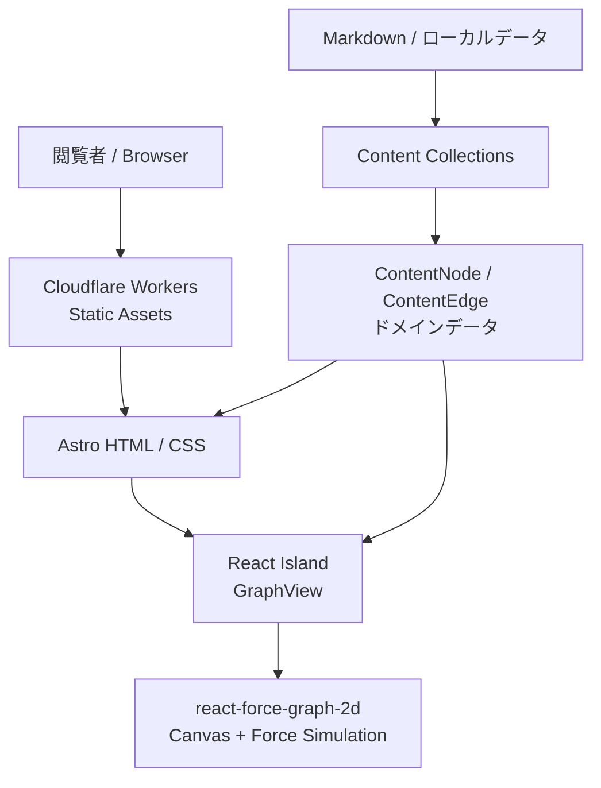
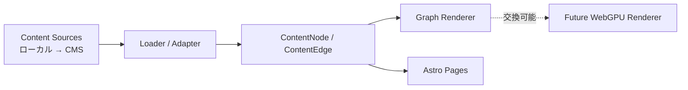
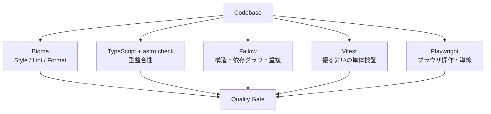
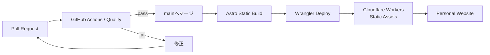
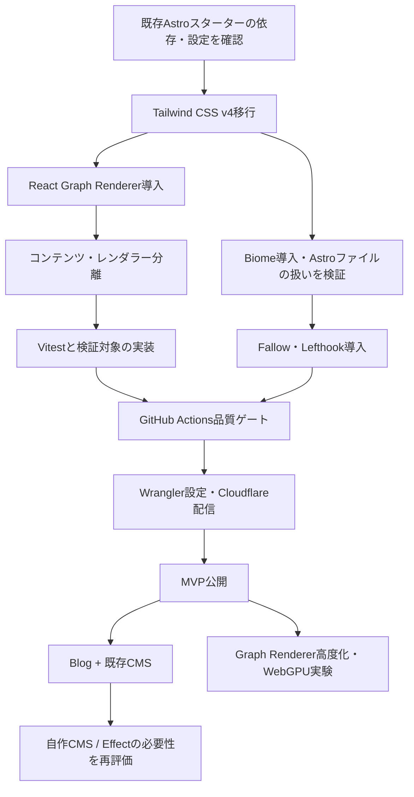

# 技術スタック・コード品質・デプロイ設計

> Status: Proposed baseline / MVP v0.1  
> Updated: 2026-10-12  
> Scope: Personal Knowledge Website（Portfolio / Knowledge Graph）

## 1. 目的と設計原則

**「アイデアは、日常に転がっている。」** 日常の疑問、試行錯誤、作品、記事がつながる個人サイトを作る。初期段階は静的配信に限定し、ブログ・既存CMS・自作CMS・独自グラフレンダラーへ段階的に拡張する。

| 原則 | 方針 |
| --- | --- |
| 小さく公開する | MVPではDB、認証、APIサーバー、SSRを導入しない |
| 必要な場所だけ動的化 | Astroによる静的HTMLを主とし、グラフだけReact Islandにする |
| 表示とコンテンツを分離 | CMSのAPI形式をUIコンポーネントに流入させない |
| レンダラー交換に備える | Node / EdgeのドメインモデルにCanvas座標やforce simulation内部状態を保存しない |
| 品質ゲートを自動化 | Format・Lint・型・構造解析・テスト・ビルドを役割分担させる |
| 過剰な抽象化を避ける | 実在しない将来要件向けのレイヤーやパッケージは作らない |

## 2. 技術選定一覧

| 領域 | 採用 | フェーズ | 責務・根拠 |
| --- | --- | --- | --- |
| メインフレームワーク | Astro | MVP | ルーティング、静的生成、コンテンツ管理 |
| インタラクティブUI | React | MVP | グラフ操作と選択状態 |
| 言語 | TypeScript（strict） | MVP | 型による整合性確保 |
| スタイル | Tailwind CSS v4 | MVP | デザイントークン・ユーティリティ |
| グラフ | `react-force-graph-2d` | MVP | Canvasによるforce-directed graphの試作 |
| コンテンツ | Astro Content Collections | MVP | 作品・記事リンク等のスキーマ付きローカルデータ |
| 型・スキーマ | AstroのZod連携 | MVP | コンテンツ入力の検証 |
| Lint / Format | Biome | MVP | JS / TS / TSX / CSS / JSONの整形・静的解析 |
| Astroファイル整形 | Prettier + `prettier-plugin-astro`（必要時） | 条件付き | Biomeの`.astro`サポート確認後に限定導入 |
| 構造健全性 | Fallow | MVP | 未使用コード、依存関係、循環参照、重複・複雑性分析 |
| 型検査 | `astro check` / TypeScript | MVP | `.astro`を含む型検証 |
| Unit Test | Vitest | MVP | グラフ変換・関係判定などの純粋関数 |
| E2E | Playwright | MVP後半 | グラフの操作、リンク遷移、主要導線 |
| Git Hooks | Lefthook | MVP | コミット前の高速な検証 |
| CI/CD | GitHub Actions | MVP | PR検証、本番デプロイ |
| 配信 | Cloudflare Workers Static Assets | MVP | Astro静的成果物の配信 |
| 非同期副作用 | Effect | ブログ/CMS導入時 | CMSアクセス・エラー処理・リトライ・Schema |
| CMS | 既存Headless CMS（製品未決定） | ブログ | 記事編集UI・コンテンツ取得 |
| 自作CMS | API + DB + 管理画面（技術未決定） | 将来 | 既存CMSの置き換え |
| 独自グラフ描画 | WebGPU、必要に応じてRust/WASM | 研究 | スケール・表現の検証後に判断 |

> **選定上の留保:** Biomeによる`.astro`の完全な整形・解析はバージョンと実験的サポートに依存する。MVPの品質ゲート対象範囲を確認してから有効化する。Effectは「将来の採用候補」であって、未使用の段階で依存を追加しない。

## 3. 実行時アーキテクチャ



- Astroはページ構成とSEO用の静的HTMLを担当する。
- Reactはグラフ領域だけでhydrationする。ブラウザAPI前提なら`client:only="react"`を検討する。
- グラフはコンテンツ探索の補助。全情報に通常のHTMLリンクから到達できることを必須とする。
- グラフ描画ライブラリがノードへ書き込む座標やリンク参照は、表示用のコピー上だけで扱う。

## 4. データの依存方向



| モデル | 主な属性 | ルール |
| --- | --- | --- |
| `ContentNode` | `id`, `type`, `title`, `slug`, `href?` | IDは安定させる。位置情報は保持しない |
| `ContentEdge` | `sourceId`, `targetId`, `relation` | 参照先は存在するノードに限定する |
| `ContentItem` | タイトル、概要、公開日、タグ等 | CMS固有の画像・リッチテキスト表現をUIへ漏らさない |

```ts
export type NodeType = "idea" | "work" | "post" | "experiment";
export type RelationType = "inspired" | "implements" | "explains" | "related";

export interface ContentNode {
  id: string;
  type: NodeType;
  title: string;
  href?: string;
}

export interface ContentEdge {
  sourceId: string;
  targetId: string;
  relation: RelationType;
}
```

## 5. コード品質ツールの分担



| タイミング | チェック | 運用 |
| --- | --- | --- |
| 編集中 | エディタのBiome / TypeScript | 高速フィードバック |
| pre-commit | Biome（ステージ済み対象） | 自動整形とコミットの境界は運用方針に合わせる |
| ローカル全体確認 | `pnpm lint`, `pnpm check`, `pnpm analyze` | 作業区切りに実行 |
| PR | Biome、型、Vitest、`fallow audit`、Build | 原則必須 |
| リリース前 | Playwright、モバイル操作、アクセシビリティ | 主要シナリオを確認 |

**Fallowの運用:** 初回は全体解析でベースラインを確認し、PRでは`fallow audit`を使う。比較元ブランチの履歴が必要なので、CIで`fetch-depth: 0`など適切なfetchを行う。検出項目や厳格度は実際の出力を見て設定する。

## 6. ビルド・デプロイ



| 項目 | 決定 |
| --- | --- |
| リポジトリ | GitHub（単一サイト用リポジトリ） |
| ビルド | `pnpm build` → `dist/` |
| 配信方式 | Cloudflare Workers Static Assets |
| デプロイCLI | Wrangler |
| 本番 | `main`マージ後の成功したワークフローからデプロイ |
| シークレット | Cloudflare認証情報をGitHub Actions Secrets等で管理 |
| Preview | PRプレビューは追って設定。MVPのブロッカーにはしない |
| SSR | 初期は利用しない。必要になればCloudflare adapterを検討 |

最小の`wrangler.jsonc`例：

```jsonc
{
  "$schema": "node_modules/wrangler/config-schema.json",
  "name": "personal-knowledge-website",
  "compatibility_date": "2026-10-12",
  "assets": {
    "directory": "./dist"
  }
}
```

`main`やCloudflare adapterは**静的配信のみなら不要**。後からSSRへ移る場合は構成を再検討する。

## 7. package.json スクリプト案

```json
{
  "scripts": {
    "dev": "astro dev",
    "build": "astro build",
    "preview": "astro preview",
    "check": "astro check",
    "lint": "biome check .",
    "lint:fix": "biome check --write .",
    "analyze": "fallow",
    "analyze:pr": "fallow audit",
    "test": "vitest run",
    "test:e2e": "playwright test",
    "deploy": "pnpm build && wrangler deploy"
  }
}
```

**注意:** 上記は導入後の目標状態。既存の`package.json`を書き換えたわけではない。`fallow audit`を実行する際は比較対象ブランチが利用可能であることを確認する。

## 8. 導入順序と依存関係



### 既存スターターとの差分（要対応）

既存のプロジェクトを確認した時点では、`package.json`にTailwind CSS 3、`@astrojs/tailwind`、Astro 5系の範囲指定があり、Biome・Fallow・Wrangler等はまだ追加されていない。したがって**本書は決定記録であり、依存関係の更新・ビルド成功を示すものではない**。

| 変更箇所 | 対応 |
| --- | --- |
| `astro.config.mjs` | Tailwind v4のViteプラグイン方式へ見直す |
| `package.json` | 採用ツールとscriptsを反映し、バージョン互換性を検証する |
| `src/components/` | 独自SVGグラフから`react-force-graph-2d`へ段階的に移行 |
| `biome.json` | 対象ファイル、除外、フォーマット方針を定義 |
| `lefthook.yml` | コミット前の高速検証のみ実行 |
| `wrangler.jsonc` | 静的アセットの配信を設定 |
| `.github/workflows/` | CIとデプロイワークフローを分離 |

## 9. 後から追加するもの・追加しないもの

| カテゴリ | 今は見送る理由 | 再検討条件 |
| --- | --- | --- |
| Effect | CMSやAPIの副作用がまだない | CMS取得・再試行・Typed Error処理が複雑化したら |
| TanStack Query | クライアントサイドで取得するデータがない | ライブ検索などを追加する場合 |
| 自作CMS / DB | 初期公開に不要 | ブログ運用が始まり、CMSの要件が固まったら |
| React Flow | 編集用キャンバスが主用途ではない | グラフ編集UIが要件になったら |
| WebGPU / WASM | 初期ノード数では費用対効果が不明 | 性能・表現上の具体的課題が測定されたら |
| SSR | 静的なコンテンツを提供できる | ユーザーごとの動的ページなどが必要になったら |

## 10. Definition of Done

- [ ] HomeとWorksが公開され、通常リンクから全主要情報にアクセスできる
- [ ] グラフがノードを選択・強調・詳細表示できる
- [ ] キーボード操作向けの代替導線がある
- [ ] `prefers-reduced-motion`に対応している
- [ ] コンテンツモデルがグラフ描画ライブラリから独立している
- [ ] Biome・Astro Check・Vitest・Fallow・BuildがCIで実行される
- [ ] 主要E2Eテストが通る
- [ ] Cloudflare Workersの静的配信で公開できる
- [ ] 現在採用していない技術の導入理由を再評価できる

## 11. 参考情報

- [Astro on Cloudflare Workers](https://developers.cloudflare.com/workers/framework-guides/web-apps/astro/)
- [Astro Cloudflare Deployment](https://docs.astro.build/en/guides/deploy/cloudflare/)
- [Workers Static Assets](https://developers.cloudflare.com/workers/static-assets/)
- [Fallow: Repository / Quickstart](https://github.com/fallow-rs/fallow)
- [Fallow Audit](https://fallow.tools/docs/cli/audit/)
- [Biome](https://biomejs.dev/)
- [Astro Content Collections](https://docs.astro.build/en/guides/content-collections/)
- [react-force-graph](https://github.com/vasturiano/react-force-graph)
