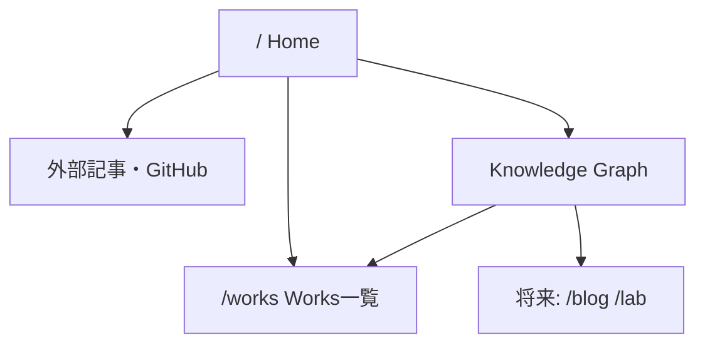

# 情報設計・画面仕様

## サイトマップ

## Home
1. Header: サイト名とHome/Worksへの通常リンク
2. Hero: 「アイデアは、日常に転がっている。」
3. Interactive Graph: Ideas / Works / Writing / Lab / Aboutと関係
4. Philosophy: 日常の不便→着想→試作・検証
5. Featured Works: 選定後の作品カード
6. About / Footer: 自己紹介と連絡先

## Graphの振る舞い
- 初期選択はIdeas
- ノードを押すと選択状態と説明が変わる
- 選択ノードからつながる線とノードを強調する
- 画面遷移はプレビュー内の明示的なリンクから行う
- ホバー専用の重要情報は置かない
- 静止した初期配置を採用し、ドラッグは行わない

## レスポンシブ
デスクトップ: グラフと説明パネルを横並び。モバイル: グラフの下に説明パネル。

## アクセシビリティ
- SVGノードは装飾表示、同じ選択機能をHTML buttonとして提供する
- reduced-motion時はトランジションを無効化
- グラフが利用できなくても通常ナビからコンテンツに到達可能
